# Group Policy Objects (GPO)

## Présentation

Les Group Policy Objects (GPO) permettent d'appliquer des paramètres de configuration et de sécurité aux utilisateurs et aux ordinateurs d'un domaine Active Directory.

Dans ce laboratoire, plusieurs GPO ont été mises en œuvre afin de reproduire des besoins couramment rencontrés en entreprise :

- standardisation des postes ;
- sécurisation des utilisateurs ;
- déploiement de ressources ;
- limitation de certaines fonctionnalités.

---

# Objectifs

Les principaux objectifs de cette partie du projet étaient :

- Comprendre le fonctionnement des GPO ;
- Administrer les postes de manière centralisée ;
- Automatiser certaines tâches ;
- Renforcer la sécurité des utilisateurs et des ordinateurs ;
- Découvrir la stratégie de groupe dans un environnement Active Directory.

---

# Fonctionnement des GPO

Les GPO sont stockées au niveau du domaine Active Directory.

Elles peuvent être appliquées :

- au domaine ;
- à une OU ;
- à un groupe d'utilisateurs ;
- à un groupe d'ordinateurs.

Les postes récupèrent automatiquement les stratégies lors de l'ouverture de session ou lors d'une actualisation des stratégies.

---

## Actualisation des stratégies

Pour forcer l'application immédiate d'une GPO :

```powershell
gpupdate /force
```

Cette commande a été utilisée à plusieurs reprises lors des phases de test.

---

# GPO déployées

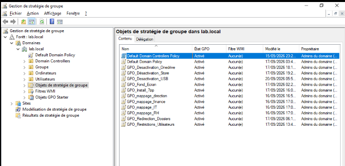

*Figure 1 - Vue d'ensemble des objets de stratégie de groupe (GPO) déployés dans le domaine Active Directory.*

## Fond d'écran d'entreprise

### Objectif

Uniformiser l'apparence des postes utilisateurs.

### Mise en œuvre

Le fond d'écran est stocké sur un partage réseau accessible en lecture seule.

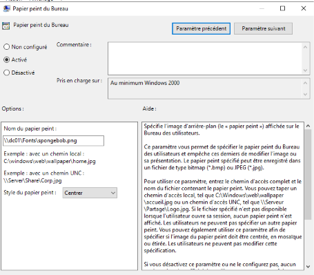

*Figure 2 - Configuration de la GPO Fond d'écran appliquée aux utilisateurs du domaine.*
### Résultat

Tous les utilisateurs reçoivent automatiquement le même fond d'écran lors de leur connexion.


*Figure 3 - GPO Fond d'écran appliqué à tous les postes du domaine.*

### Compétences acquises

- Utilisation des chemins UNC ;
- Gestion des partages réseau ;
- Paramètres utilisateur.

---

## Mappage des lecteurs réseau

### Objectif

Fournir automatiquement l'accès aux ressources partagées.


*Figure 4 - Configuration du mappage automatique des lecteurs réseau via GPO.*

### Résultat

Les lecteurs réseau apparaissent automatiquement pour les utilisateurs concernés. 

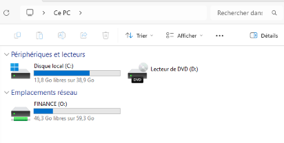


*Figure 5 - Lecteur réseau automatiquement monté sur le poste client après application de la stratégie.*

### Compétences acquises

- Préférences GPO ;
- Gestion des ressources réseau ;
- Centralisation des accès.

---

## Redirection de dossiers

### Objectif

Centraliser les données utilisateurs sur le serveur.

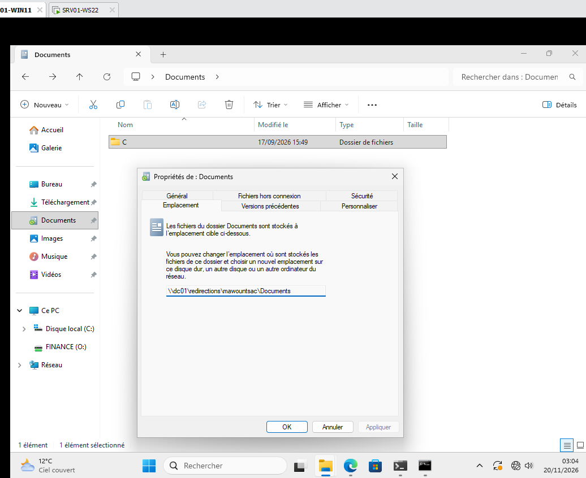

*Figure 6 - Configuration de la redirection des dossiers utilisateurs vers le serveur.*

### Dossiers concernés

- Documents
- Bureau

### Résultat

Les données sont stockées sur le serveur plutôt que localement.

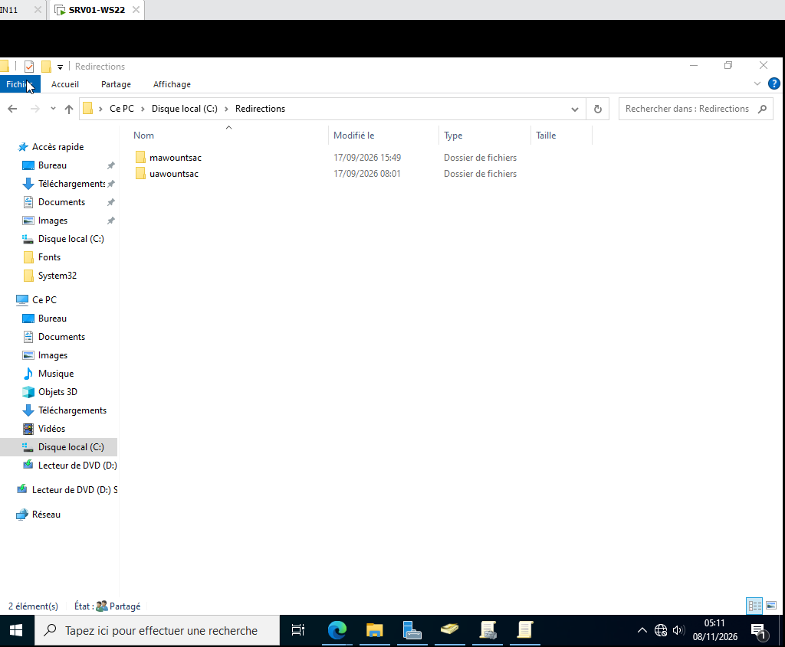

*Figure 7 - Configuration de la redirection des dossiers utilisateurs vers le serveur.*

### Compétences acquises

- Gestion des profils utilisateurs ;
- Stockage centralisé ;
- Disponibilité des données.

---

## Restrictions utilisateur

### Objectif

Limiter certaines actions sur les postes de travail.

### Exemples


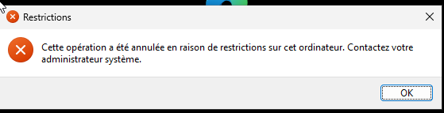

*Figure 8 - Message d'erreur dû à une tentative d'ouverture du panneau de configuration depuis un poste client.*

- Limitation de fonctionnalités système ;
- Restriction d'accès à certains paramètres Windows.

### Compétences acquises

- Gestion des paramètres utilisateur ;
- Durcissement de l'environnement Windows.

---

## Déploiement d'applications MSI

### Objectif

Installer automatiquement un logiciel sur les postes du domaine.

### Configuration

Le déploiement est réalisé via un paquet MSI.

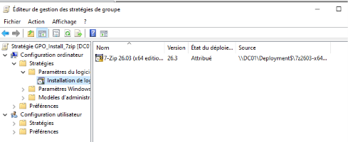

*Figure 9 - Configuration du déploiment automatique du logiciel 7-Zip à l'aide d'une stratégie de groupe.*


### Difficulté rencontrée

Le déploiement ne fonctionnait pas initialement.

### Cause

Les autorisations nécessaires n'étaient pas appliquées au groupe :

```text
Ordinateurs du domaine
```

### Résolution

Ajout des droits :

- Lecture ;
- Appliquer la stratégie de groupe.

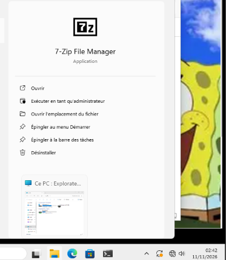

*Figure 10 - Logiciel 7-Zip installé automatiquement sur le poste client après application de la GPO.*

### Compétences acquises

- Déploiement logiciel centralisé ;
- Dépannage GPO ;
- Gestion des autorisations.

---

## Désactivation de OneDrive

### Objectif

Empêcher l'utilisation de OneDrive dans l'environnement du laboratoire.

### Résultat

Le service OneDrive (synchronisation) devient indisponible pour les utilisateurs.

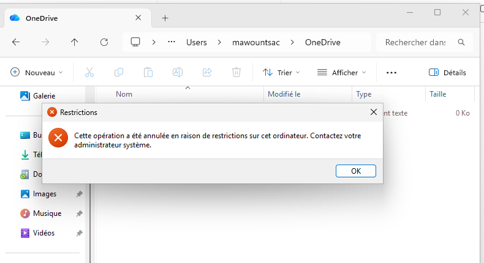

*Figure 11 - Accès à OneDrive bloqué par la stratégie GPO_Desactivation_Onedrive.*

### Compétences acquises

- Gestion des composants Windows ;
- Contrôle des services cloud.

---

## Désactivation du Microsoft Store

### Objectif

Limiter l'installation libre d'applications.

### Résultat

Les utilisateurs ne peuvent plus utiliser le Microsoft Store.

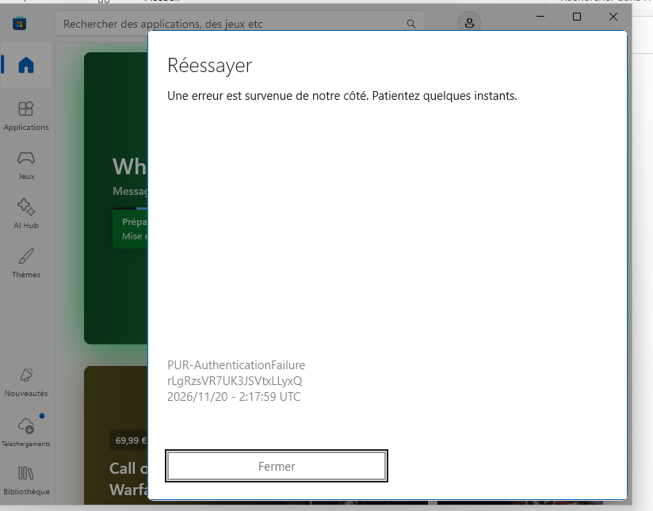

*Figure 12 - Désactivation du Microsoft Store*

### Compétences acquises

- Contrôle des applications ;
- Politique de sécurité poste.

---

## Blocage des périphériques USB

### Objectif

Limiter les risques de fuite ou d'introduction de données.

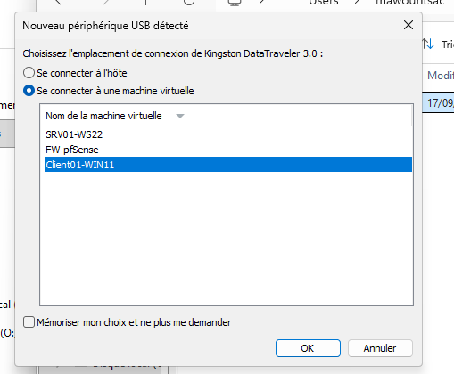

*Figure 13 - Clé USB branchée sur la VM client*


### Résultat

Les périphériques de stockage USB sont bloqués.

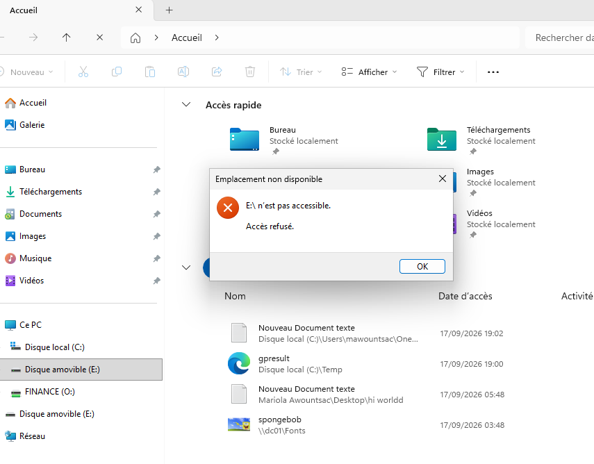

*Figure 14 - Blocage des périphériques USB*

### Compétences acquises

- Sécurisation des postes ;
- Gestion des périphériques ;
- Politique de sécurité.

---
# Validation

L'ensemble des stratégies a été testé depuis le poste :

```text
DESKTOP-RNDT6FD
```

Les tests ont permis de vérifier :

- l'application correcte des GPO ;
- la réplication des paramètres ;
- le comportement attendu des utilisateurs.

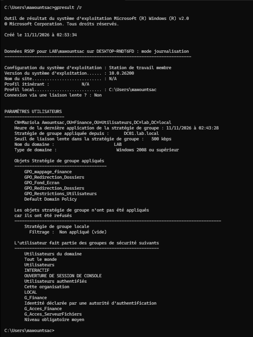

*Figure 15 - Résultat de la commande gpresult /r /scope computer démontrant l'application des stratégies ordinateur.*

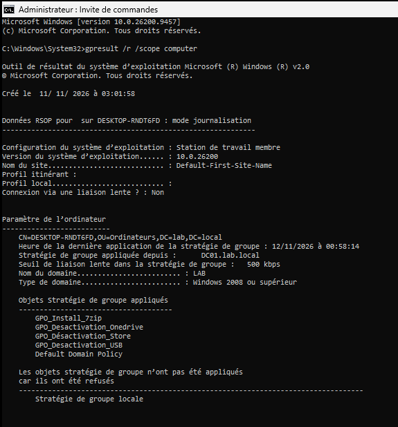

*Figure 16 - Résultat de la commande gpresult /r démontrant l'application des stratégies utilisateur sur le poste client.*

---

## Paramètres de sécurité du domaine

Des paramètres de sécurité complémentaires ont également été configurés au niveau du domaine :

- complexité des mots de passe ;
- longueur minimale ;
- historique des mots de passe ;
- expiration des mots de passe.

Ces paramètres sont appliqués via la stratégie de domaine par défaut (Default Domain Policy).

# Difficultés rencontrées

## Déploiement MSI

L'installation automatisée d'un logiciel via GPO a nécessité plusieurs phases de diagnostic.

L'analyse des autorisations de sécurité de la stratégie a permis d'identifier l'origine du problème.

Cette étape a fortement contribué à la compréhension du mécanisme de filtrage des stratégies de groupe.

---

# Intérêt en entreprise

Les GPO permettent de :

- standardiser les postes ;
- renforcer la sécurité ;
- réduire les tâches manuelles ;
- déployer des ressources à grande échelle ;
- appliquer des règles homogènes sur l'ensemble du domaine.

---

# Compétences développées

- Administration des GPO ;
- Sécurité Windows ;
- Déploiement logiciel ;
- Gestion des profils utilisateurs ;
- Gestion des ressources réseau ;
- Diagnostic de problèmes GPO ;
- Application de stratégies centralisées.
